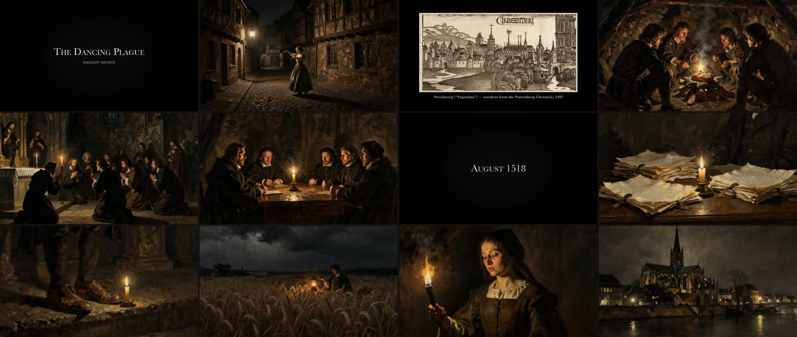
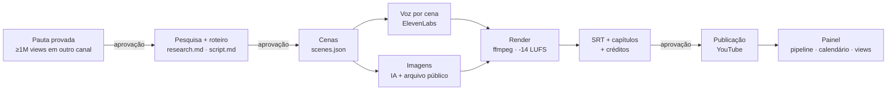
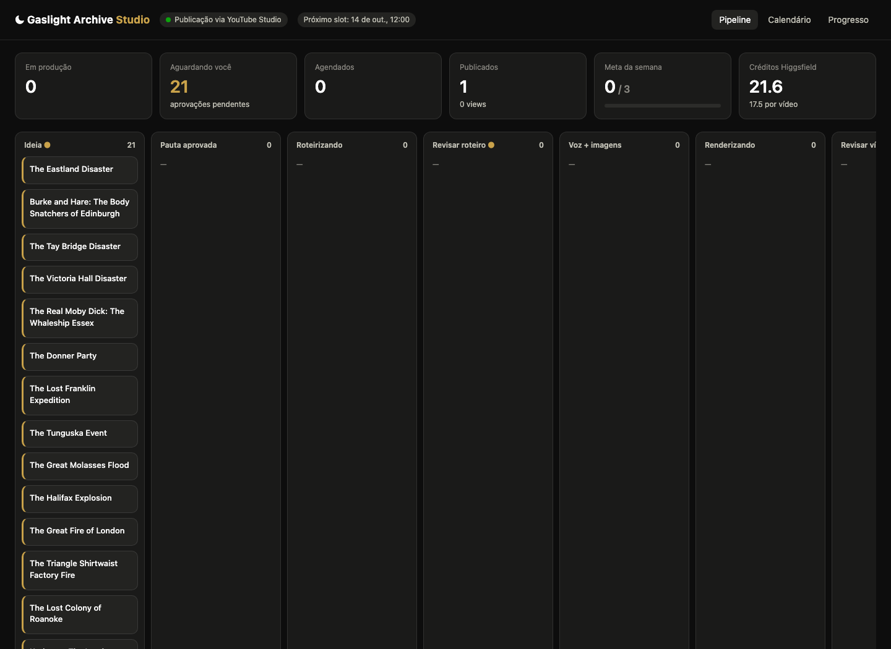

<p align="center"></p>

# Gaslight Archive Studio

Pipeline de ponta a ponta que produz e publica documentários de história para o canal
[@gaslightarchive](https://youtube.com/@gaslightarchive): pesquisa com fontes → roteiro →
narração e imagens por IA → montagem em ffmpeg → SEO → publicação → acompanhamento num painel.

Um agente (Claude Code) faz o trabalho de produtor seguindo um playbook versionado
([`CLAUDE.md`](CLAUDE.md)). O estúdio local cuida do que precisa ser determinístico:
banco, render, agenda, upload e métricas. Uma pessoa aprova em três pontos — pauta, roteiro
e vídeo final — porque é o que separa conteúdo com autoria de conteúdo em massa.

**Primeiro vídeo no ar:** [The Dancing Plague of 1518: Did It Really Kill 15 People a Day?](https://youtu.be/Hn9S3rbu7yU)

<p align="center"></p>

## Como funciona



| Etapa | O que faz | Onde |
|---|---|---|
| Pauta | Só entra tema que já passou de 1M views em algum vídeo; a prova fica registrada | `cli idea` |
| Roteiro | Estrutura em 5 atos modelada a partir da análise frame a frame de um canal de referência | [`referencias/`](referencias/) |
| Cenas | Cada cena é IA, foto/gravura de arquivo (sépia + moldura + legenda) ou cartão de texto | [`scenes.json`](videos/the-dancing-plague-of-1518/scenes.json) |
| Voz | Uma chamada de TTS por cena, então a sincronia imagem/voz é exata, sem alinhamento forçado | Higgsfield → ElevenLabs |
| Render | Ken Burns em 4K → 1080p, segmentos em paralelo e com cache, trilha, loudness normalizado | [`studio/render.js`](studio/render.js) |
| Cartões | Títulos e datas em versalete, tratamento de imagem de arquivo | [`studio/cards.py`](studio/cards.py) |
| Legendas e capítulos | SRT e capítulos da descrição gerados dos tempos reais de cada cena | `render.js` |
| Compilações | Junta vídeos prontos num longo, com capítulos e legendas deslocadas — custo zero | [`studio/compile.js`](studio/compile.js) |
| Publicação | YouTube Data API (OAuth) ou YouTube Studio guiado pelo agente no navegador | [`studio/youtube.js`](studio/youtube.js) |
| Painel | Pipeline kanban com portões de aprovação, calendário de slots, produção semanal vs. meta, custo por vídeo | [`dashboard/`](dashboard/) |

<p align="center"></p>

## Decisões de engenharia

- **Zero dependências para o núcleo.** Servidor HTTP, banco (`node:sqlite`) e CLI usam só a biblioteca padrão do Node 24. A única dependência é `googleapis`.
- **Render incremental.** Cada cena vira um segmento próprio; mudou a imagem, o áudio ou o `scenes.json`, só aquele segmento é refeito. Encoder de hardware (VideoToolbox) e três cenas em paralelo: um vídeo de 5 min renderiza em ~1,5 min num Mac.
- **Upload de arquivos grandes sem passar pela automação.** A extensão de navegador só aceita arquivos de até 10 MB; o servidor libera CORS + Private Network Access *apenas* para a origem do YouTube Studio, e a própria página busca o vídeo de 300 MB no `localhost`.
- **Custo rastreado por vídeo.** Todo crédito gasto em voz e imagem fica registrado, e o painel mostra a média real por vídeo publicado.
- **Conformidade como requisito.** Toda imagem de arquivo carrega licença e crédito, que entram automaticamente na descrição; todo vídeo é declarado como contendo mídia sintética.

## Rodando

```bash
npm install
npm run painel                                  # http://localhost:4400
npm run cli -- idea "The Tay Bridge Disaster" --angle "..."
npm run cli -- render <slug>                     # final.mp4 + captions.srt + chapters.json
npm run cli -- compile "Title" <slug1> <slug2>   # compilação
npm run cli -- list
```

Requer Node 24+, ffmpeg e Python 3 com Pillow. Mídia gerada (vídeos, áudios, imagens) e segredos ficam fora do repositório.

## Estrutura

```
studio/      servidor, CLI, render, cartões, compilação, agenda, YouTube
dashboard/   painel (HTML + JS puro, sem build)
videos/      um diretório por vídeo: pesquisa, roteiro, cenas, SEO, legendas
referencias/ análise do canal de referência que guia a estrutura dos roteiros
assets/      identidade visual do canal
CLAUDE.md    playbook que o agente segue em cada produção
```
